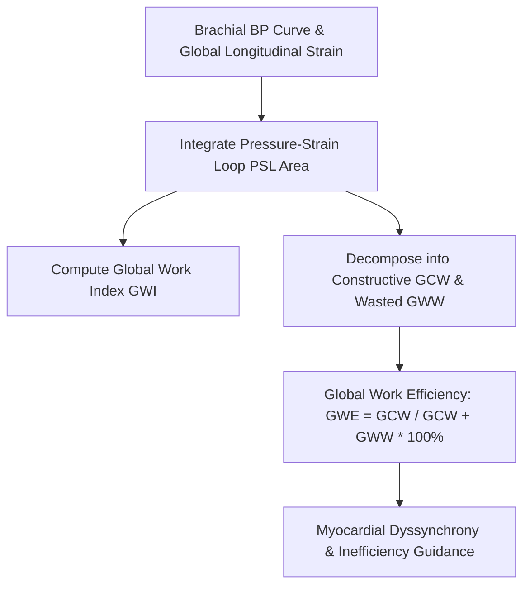

# Cardiac Ventricular Myocardial Work Index (GWI) Skill

[](LICENSE)
[](https://www.python.org/)
[](https://openclaw.org/)
[](https://alphapark.ai/)
[](https://modelcontextprotocol.io/)

Non-invasive Left Ventricular Myocardial Work Index (GWI) and Global Work Efficiency (GWE%) Analyzer based on echocardiographic pressure-strain loop physics.



## Features
- **Zero PIP Dependencies**: Implemented strictly with Python Standard Library (`math`, `json`, `sys`, `typing`).
- **EACVI/ASE Standard Formulation**: Non-invasive estimation of left ventricular pressure-strain loops.
- **Dyssynchrony & Afterload Resolution**: Disentangles hypertension-induced afterload from intrinsic myocardial failure.
- **Dual Architecture**: Native Python import and Model Context Protocol (MCP) JSON-RPC 2.0 stdio server.

## Quickstart
```bash
python example_usage.py
```

## License
Apache-2.0
